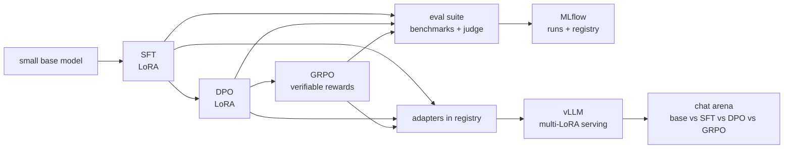

# Roadmap

> Take a small open base model through the full post-training pipeline: supervised fine-tuning,
> preference tuning (DPO) and reinforcement learning with verifiable rewards (GRPO). Every stage
> is measured, and the three versions can be compared side by side in a chat arena.

Status: **planned** · no milestone started. A milestone is finished when its heading ends in "(done)".

## What it does

1. **SFT**: teach the base model to follow instructions and a chat format.
2. **DPO**: tune it on preference pairs (chosen vs rejected answers) to be more helpful and
   better formatted.
3. **GRPO**: reinforcement learning on tasks with checkable answers (maths word problems,
   JSON-format tasks), where the reward is computed by code, not by another model.
4. **Evaluate** each stage on the same benchmarks plus an LLM-as-judge win rate.
5. **Serve** all stages as LoRA adapters on one base model, with a chat arena to compare them.

## What it proves

- The modern post-training stack end to end, not just one fine-tune.
- Experimental discipline: configs in git, seeds, every run in MLflow, ablations.
- Evaluation literacy: benchmarks, judge models and their biases, contamination checks.
- Cost awareness: everything on a small model and single GPUs, with numbers for time and money.

Distinct from the other repos: text only, and the training itself is the product.

## Architecture



## Stack and why

| Need | Choice | Why |
|---|---|---|
| Base model | a small open base model (Qwen3 family, 1.7B-4B) | trainable on one GPU; strong for its size |
| Training library | **TRL** (SFTTrainer, DPOTrainer, GRPOTrainer) | the standard open implementation of all three stages |
| Efficiency | **Unsloth** + LoRA/QLoRA | lower memory, faster steps on one GPU |
| Rollouts for GRPO | vLLM generation inside TRL | GRPO is generation-heavy; vLLM makes it affordable |
| Benchmarks | **lm-evaluation-harness** (GSM8K, IFEval, MMLU subset) | standard, comparable numbers |
| Judge | LLM-as-judge on a held-out prompt set, position-swapped | win rate vs previous stage; position bias controlled |
| Config | YAML per run, committed | any number in the README can be reproduced |
| Tracking | MLflow | runs, curves, adapters, eval tables |
| Serving | **vLLM** multi-LoRA | one base model, four "versions" at the cost of one |

## Data

- SFT: an open instruction dataset (for example a filtered subset of an open SFT mix such as
  SmolTalk or Tulu 3), plus a small set of German examples.
- DPO: an open preference dataset (for example UltraFeedback, binarised).
- GRPO: GSM8K-style maths word problems (answer checked by code) and a JSON-formatting task
  (output checked by a schema validator).
- Held-out judge set: about 200 prompts never used in training, decontaminated against all
  training data (n-gram overlap check).

## Evaluation

| Metric | After stage |
|---|---|
| IFEval (instruction following) | SFT, DPO |
| GSM8K accuracy | GRPO (main), all stages for comparison |
| MMLU subset | all stages, to catch forgetting |
| Judge win rate vs previous stage | SFT, DPO |
| JSON validity on format task | GRPO |
| Training cost (GPU hours, $) | every stage |

## Milestones

### M0 - Skeleton
uv, CLAUDE.md harness, CI, config system, eval runner wired to lm-evaluation-harness, baseline
numbers for the base model.

### M1 - SFT
LoRA SFT, chat template, eval, MLflow, adapter registered.
**Shows:** a clean, reproducible fine-tune

### M2 - DPO
Preference tuning on top of SFT, judge win rate, ablation on beta and data size.
**Shows:** preference optimisation and how to measure it

### M3 - GRPO
Reward functions (correct answer, valid format, length penalty), GRPO with vLLM rollouts,
reward curves, accuracy before/after, examples of reward hacking found and fixed.
**Shows:** RL with verifiable rewards, the current frontier of post-training

### M4 - Analysis
Forgetting check (MMLU), judge bias check (position swap, self-preference), cost table,
write-up of what each stage really changed.
**Shows:** judgement, not just running scripts

### M5 - Arena and serving
vLLM multi-LoRA, Gradio chat arena (blind A/B voting optional), Docker + Helm.

## Demo and hosting

| Level | What | Cost |
|---|---|---|
| Always works | website page: video, results table, reward curves, side-by-side examples | $0 |
| Live | Gradio arena on ZeroGPU, switching adapters on one small base model | $0, or $9/month for HF PRO quota |
| Production path | vLLM multi-LoRA endpoint on Modal, scale to zero | within free credits for demo use |

## Compute budget (estimate)

- SFT and DPO on a 1.7B-4B model with LoRA: a few GPU hours each.
- GRPO is the expensive stage: roughly 10-20 GPU hours on an A10/L4/A100-class GPU.
- Rough one-off total: $30-60 on Modal; Kaggle's free weekly GPU hours can cover SFT and DPO.

## CI/CD

- PR: lint, mypy, reward-function unit tests, a 10-step training smoke test on a tiny model
  (CPU), config validation.
- Manual GPU workflow: train a stage + evaluate, results logged to MLflow and a report committed.
- Main: build serving image, update the Space.

## Repo layout

```
configs/{sft,dpo,grpo}/*.yaml
src/align/{data,templates,rewards,train_sft,train_dpo,train_grpo,decontaminate}.py
evals/{harness.py,judge.py,prompts.jsonl}
app/arena.py
deploy/
CLAUDE.md  Makefile  docs/adr/
```

## Risks

- GRPO instability and reward hacking. Mitigation: simple, strict rewards; log samples every N
  steps; any hacking you find becomes part of the write-up.
- Judge bias. Mitigation: position swapping, a second judge on a subset, report agreement.
- Licence terms of datasets and base model: check and note them in the README.

## Interview talking points

- What SFT, DPO and GRPO each changed, with numbers, and what they cost.
- A concrete reward-hacking example and the fix.
- Why the judge needs controls, and how much its verdicts can be trusted.
